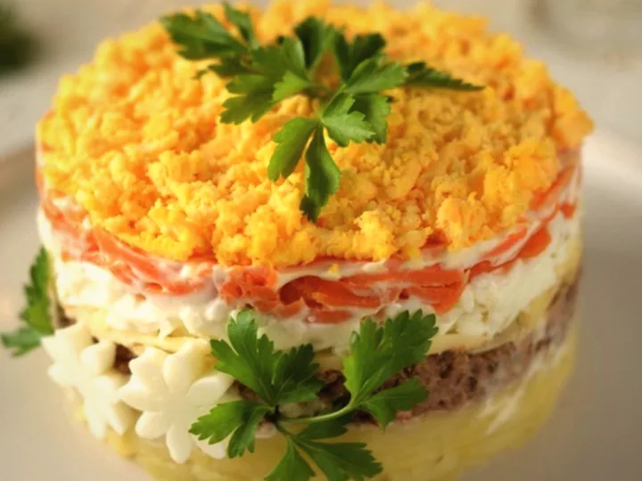

<!doctype html>
<html lang="uk">
<head>
<meta charset="utf-8">
<title>Pelmenchyk — головна</title>

</head>
<body>
<x-dc>
<helmet>
<link rel="preconnect" href="https://fonts.googleapis.com">
<link href="https://fonts.googleapis.com/css2?family=Inter:wght@400;500;600&amp;family=Playfair+Display:wght@500;600&amp;display=swap" rel="stylesheet">

</helmet>

<!-- HEADER -->
<header style="position:sticky;top:0;z-index:20;background:#F4F0E8;border-bottom:1px solid #D3A275">

<nav aria-label="Основна навігація" style="display:flex;flex-wrap:wrap;gap:6px 24px;font-size:15px;font-weight:500">
<a href="#catalog" style="padding:10px 0">Каталог</a>
<a href="#about" style="padding:10px 0">Про нас</a>
<a href="#contacts" style="padding:10px 0">Контакти</a>
</nav>
<button onClick="{{ openCart }}" aria-label="Відкрити кошик" style="display:flex;align-items:center;gap:10px;min-height:48px;padding:0 20px;border:0;border-radius:999px;background:{{accent}};color:#fff;font-size:16px;font-weight:600">
<svg width="22" height="22" viewBox="0 0 24 24" fill="none" stroke="currentColor" stroke-width="2" stroke-linecap="round" stroke-linejoin="round" aria-hidden="true"><circle cx="9" cy="20" r="1.5"></circle><circle cx="18" cy="20" r="1.5"></circle><path d="M2 3h3l2.6 12.4a2 2 0 0 0 2 1.6h7.7a2 2 0 0 0 2-1.5L21 8H6"></path></svg>
Кошик
{{cartCount}}
</button>

</header>

<main id="top">

<!-- HERO -->
<section style="max-width:1200px;margin:0 auto;padding:40px 20px 24px;display:flex;flex-wrap:wrap;align-items:center;gap:40px">

<h1 style="margin:0;line-height:0"></h1>

<a href="#catalog" style="display:inline-flex;align-items:center;min-height:52px;padding:0 28px;border-radius:999px;background:#fff;border:2px solid #A93118;color:#A93118;font-weight:600;font-size:16px">Переглянути меню</a>
<button onClick="{{ openCart }}" style="min-height:52px;padding:0 32px;border:0;border-radius:999px;background:{{accent}};color:#fff;font-weight:600;font-size:16px">Замовити</button>

<section aria-label="Улюблені страви" style="position:relative;border-radius:40px;overflow:hidden;isolation:isolate;clip-path:inset(0 round 40px);background:linear-gradient(145deg,#D3A275 0%,#E4CBA8 55%,#F4F0E8 100%);padding:28px 20px 20px;display:flex;flex-direction:column;align-items:center;gap:18px">

<button onClick="{{ togglePause }}" aria-pressed="{{showPaused}}" aria-label="{{pauseLabel}}" style="position:absolute;top:16px;right:16px;z-index:3;width:44px;height:44px;border-radius:22px;border:0;background:rgba(255,247,242,.88);color:#3E2315;display:flex;align-items:center;justify-content:center">
<sc-if value="{{showPaused}}" hint-placeholder-val="{{ false }}"><svg width="18" height="18" viewBox="0 0 24 24" fill="currentColor" aria-hidden="true"><path d="M7 4.5v15l12-7.5z"></path></svg></sc-if>
<sc-if value="{{showRunning}}" hint-placeholder-val="{{ true }}"><svg width="18" height="18" viewBox="0 0 24 24" fill="currentColor" aria-hidden="true"><rect x="6" y="4.5" width="4.5" height="15" rx="1.2"></rect><rect x="13.5" y="4.5" width="4.5" height="15" rx="1.2"></rect></svg></sc-if>
</button>

<sc-for list="{{show}}" as="x" hint-placeholder-count="5">

</sc-for>

<sc-for list="{{show}}" as="x" hint-placeholder-count="5">

Улюблена страва

{{x.l1}}

{{x.l2}}

{{x.priceText}}

{{x.weight}}

<button onClick="{{ x.add }}" style="min-height:48px;border:0;border-radius:999px;background:{{accent}};color:#fff;font-size:16px;font-weight:600">Додати до кошика</button>

</sc-for>

<sc-for list="{{show}}" as="x" hint-placeholder-count="5">
<button onClick="{{ x.pick }}" aria-label="{{x.ariaLabel}}" aria-pressed="{{x.pressed}}" style="{{x.thumbStyle}}">

{{x.short}}
</button>
</sc-for>

</section>

</section>

<!-- CATEGORIES -->
<section style="max-width:1200px;margin:0 auto;padding:40px 20px 8px">
<h2 style="margin:0 0 24px;font-family:'Playfair Display',serif;font-size:36px;font-weight:600">Категорії</h2>

<sc-for list="{{cats}}" as="c" hint-placeholder-count="6">
<button onClick="{{ c.pick }}" style="border:0;padding:0;text-align:left;border-radius:28px;overflow:hidden;background:#F4F0E8;box-shadow:0 2px 0 rgba(103,58,37,0.12)" aria-label="{{c.label}}">

<sc-if value="{{c.kPelmeni}}" hint-placeholder-val="{{ false }}"></sc-if>
<sc-if value="{{c.kVareniki}}" hint-placeholder-val="{{ false }}"></sc-if>
<sc-if value="{{c.kMlynci}}" hint-placeholder-val="{{ false }}"></sc-if>
<sc-if value="{{c.kBorsch}}" hint-placeholder-val="{{ false }}"></sc-if>
<sc-if value="{{c.kSyrniki}}" hint-placeholder-val="{{ false }}"></sc-if>
<sc-if value="{{c.kUzvar}}" hint-placeholder-val="{{ false }}"><svg viewBox="0 0 260 200" preserveAspectRatio="xMidYMid slice" style="display:block;width:100%;height:100%" aria-hidden="true">
<circle cx="130" cy="106" r="72" fill="#673A25" opacity=".14"></circle><circle cx="130" cy="100" r="70" fill="#F4F0E8"></circle><circle cx="130" cy="100" r="58" fill="none" stroke="#E1D3BC" stroke-width="3"></circle>
<rect x="150" y="136" width="34" height="8" rx="4" fill="#A3623C" transform="rotate(-30 150 136)"></rect>
<circle cx="130" cy="100" r="46" fill="#E1D3BC"></circle><circle cx="130" cy="100" r="41" fill="#F4F0E8"></circle><circle cx="130" cy="100" r="36" fill="#C97A4E"></circle>
<circle cx="120" cy="108" r="9" fill="#E8B878"></circle><circle cx="120" cy="108" r="3.5" fill="#C97A4E"></circle><circle cx="144" cy="96" r="8" fill="#7A3E5E"></circle><ellipse cx="128" cy="86" rx="8" ry="6" fill="#F0D6A0"></ellipse>
<path d="M104 84a30 30 0 0 1 22-14" fill="none" stroke="#fff" stroke-width="4" opacity=".55" stroke-linecap="round"></path>
<g fill="#6F8B3C"><ellipse cx="108" cy="124" rx="7" ry="2.6" transform="rotate(-30 108 124)"></ellipse><ellipse cx="150" cy="118" rx="7" ry="2.6" transform="rotate(40 150 118)"></ellipse></g>
</svg></sc-if>

{{c.name}}
{{c.countText}}

</button>
</sc-for>

</section>

<!-- CATALOG -->
<section id="catalog" style="max-width:1200px;margin:0 auto;padding:56px 20px 8px">
<h2 style="margin:0 0 20px;font-family:'Playfair Display',serif;font-size:36px;font-weight:600">Каталог</h2>

<sc-for list="{{filters}}" as="f" hint-placeholder-count="7">
<button onClick="{{ f.pick }}" aria-pressed="{{f.pressed}}" style="{{f.style}}">{{f.name}}</button>
</sc-for>

<sc-for list="{{products}}" as="p" hint-placeholder-count="6">
<article style="background:#F4F0E8;border-radius:28px;overflow:hidden;display:flex;flex-direction:column;box-shadow:0 2px 0 rgba(103,58,37,0.12)">

<sc-if value="{{p.kPelmeni}}" hint-placeholder-val="{{ false }}"><svg viewBox="0 0 260 200" preserveAspectRatio="xMidYMid slice" style="display:block;width:100%;height:100%" aria-hidden="true">
<circle cx="130" cy="106" r="72" fill="#673A25" opacity=".14"></circle><circle cx="130" cy="100" r="70" fill="#F4F0E8"></circle><circle cx="130" cy="100" r="58" fill="none" stroke="#E1D3BC" stroke-width="3"></circle>
<g transform="translate(104 78) rotate(-20)"><ellipse rx="15" ry="13" fill="#F6E3C8"></ellipse><path d="M-11-3Q0-14 11-3" fill="none" stroke="#E0BE92" stroke-width="3" stroke-linecap="round"></path></g>
<g transform="translate(134 70) rotate(10)"><ellipse rx="15" ry="13" fill="#F6E3C8"></ellipse><path d="M-11-3Q0-14 11-3" fill="none" stroke="#E0BE92" stroke-width="3" stroke-linecap="round"></path></g>
<g transform="translate(158 94) rotate(35)"><ellipse rx="15" ry="13" fill="#F6E3C8"></ellipse><path d="M-11-3Q0-14 11-3" fill="none" stroke="#E0BE92" stroke-width="3" stroke-linecap="round"></path></g>
<g transform="translate(96 108) rotate(-40)"><ellipse rx="15" ry="13" fill="#F6E3C8"></ellipse><path d="M-11-3Q0-14 11-3" fill="none" stroke="#E0BE92" stroke-width="3" stroke-linecap="round"></path></g>
<g transform="translate(126 100) rotate(0)"><ellipse rx="15" ry="13" fill="#F6E3C8"></ellipse><path d="M-11-3Q0-14 11-3" fill="none" stroke="#E0BE92" stroke-width="3" stroke-linecap="round"></path></g>
<g transform="translate(150 124) rotate(20)"><ellipse rx="15" ry="13" fill="#F6E3C8"></ellipse><path d="M-11-3Q0-14 11-3" fill="none" stroke="#E0BE92" stroke-width="3" stroke-linecap="round"></path></g>
<g transform="translate(112 132) rotate(-10)"><ellipse rx="15" ry="13" fill="#F6E3C8"></ellipse><path d="M-11-3Q0-14 11-3" fill="none" stroke="#E0BE92" stroke-width="3" stroke-linecap="round"></path></g>
<circle cx="170" cy="66" r="13" fill="#E1D3BC"></circle><circle cx="170" cy="66" r="9" fill="{{p.sauce}}"></circle>
<g fill="#6F8B3C"><ellipse cx="118" cy="90" rx="7" ry="2.6" transform="rotate(-30 118 90)"></ellipse><ellipse cx="146" cy="112" rx="7" ry="2.6" transform="rotate(20 146 112)"></ellipse><ellipse cx="102" cy="120" rx="7" ry="2.6" transform="rotate(-60 102 120)"></ellipse><ellipse cx="136" cy="82" rx="7" ry="2.6" transform="rotate(40 136 82)"></ellipse></g>
</svg></sc-if>
<sc-if value="{{p.kVarPhoto}}" hint-placeholder-val="{{ false }}"></sc-if>
<sc-if value="{{p.kPelPhoto}}" hint-placeholder-val="{{ false }}"></sc-if>
<sc-if value="{{p.kMlPhoto}}" hint-placeholder-val="{{ false }}"></sc-if>
<sc-if value="{{p.kMimPhoto}}" hint-placeholder-val="{{ false }}"></sc-if>
<sc-if value="{{p.kMedPhoto}}" hint-placeholder-val="{{ false }}"></sc-if>
<sc-if value="{{p.kVareniki}}" hint-placeholder-val="{{ false }}"><svg viewBox="0 0 260 200" preserveAspectRatio="xMidYMid slice" style="display:block;width:100%;height:100%" aria-hidden="true">
<circle cx="130" cy="106" r="72" fill="#673A25" opacity=".14"></circle><circle cx="130" cy="100" r="70" fill="#F4F0E8"></circle><circle cx="130" cy="100" r="58" fill="none" stroke="#E1D3BC" stroke-width="3"></circle>
<g transform="translate(104 76) rotate(-10)"><path d="M-20 8C-20-16 20-16 20 8Z" fill="#F6E3C8"></path><path d="M-17 8H17" stroke="#E0BE92" stroke-width="3" stroke-dasharray="3.5 3.5" stroke-linecap="round"></path></g>
<g transform="translate(152 82) rotate(25)"><path d="M-20 8C-20-16 20-16 20 8Z" fill="#F6E3C8"></path><path d="M-17 8H17" stroke="#E0BE92" stroke-width="3" stroke-dasharray="3.5 3.5" stroke-linecap="round"></path></g>
<g transform="translate(98 104) rotate(-35)"><path d="M-20 8C-20-16 20-16 20 8Z" fill="#F6E3C8"></path><path d="M-17 8H17" stroke="#E0BE92" stroke-width="3" stroke-dasharray="3.5 3.5" stroke-linecap="round"></path></g>
<g transform="translate(142 106) rotate(5)"><path d="M-20 8C-20-16 20-16 20 8Z" fill="#F6E3C8"></path><path d="M-17 8H17" stroke="#E0BE92" stroke-width="3" stroke-dasharray="3.5 3.5" stroke-linecap="round"></path></g>
<g transform="translate(112 132) rotate(-5)"><path d="M-20 8C-20-16 20-16 20 8Z" fill="#F6E3C8"></path><path d="M-17 8H17" stroke="#E0BE92" stroke-width="3" stroke-dasharray="3.5 3.5" stroke-linecap="round"></path></g>
<g transform="translate(156 130) rotate(20)"><path d="M-20 8C-20-16 20-16 20 8Z" fill="#F6E3C8"></path><path d="M-17 8H17" stroke="#E0BE92" stroke-width="3" stroke-dasharray="3.5 3.5" stroke-linecap="round"></path></g>
<g fill="{{p.sauce}}"><circle cx="104" cy="70" r="5"></circle><circle cx="154" cy="76" r="5"></circle><circle cx="96" cy="98" r="5"></circle><circle cx="142" cy="100" r="5"></circle><circle cx="112" cy="126" r="5"></circle><circle cx="158" cy="124" r="5"></circle></g>
<g fill="#6F8B3C"><ellipse cx="128" cy="86" rx="7" ry="2.6" transform="rotate(-20 128 86)"></ellipse><ellipse cx="124" cy="116" rx="7" ry="2.6" transform="rotate(30 124 116)"></ellipse><ellipse cx="172" cy="104" rx="7" ry="2.6" transform="rotate(-50 172 104)"></ellipse></g>
</svg></sc-if>
<sc-if value="{{p.kMlynci}}" hint-placeholder-val="{{ false }}"><svg viewBox="0 0 260 200" preserveAspectRatio="xMidYMid slice" style="display:block;width:100%;height:100%" aria-hidden="true">
<circle cx="130" cy="106" r="72" fill="#673A25" opacity=".14"></circle><circle cx="130" cy="100" r="70" fill="#F4F0E8"></circle><circle cx="130" cy="100" r="58" fill="none" stroke="#E1D3BC" stroke-width="3"></circle>
<g transform="translate(124 82) rotate(-6)"><rect x="-46" y="-15" width="92" height="30" rx="15" fill="#E9BE80"></rect><path d="M-34-8Q0-15 34-8" fill="none" stroke="#F6D6A0" stroke-width="3" stroke-linecap="round"></path><path d="M-30 9Q0 14 30 9" fill="none" stroke="#D49A55" stroke-width="3" stroke-linecap="round"></path><ellipse cx="46" cy="0" rx="7" ry="15" fill="#F6DDB0"></ellipse><path d="M47-7a4 7 0 1 0 0 12" fill="none" stroke="#D49A55" stroke-width="2" stroke-linecap="round"></path></g>
<g transform="translate(136 118) rotate(5)"><rect x="-46" y="-15" width="92" height="30" rx="15" fill="#E9BE80"></rect><path d="M-34-8Q0-15 34-8" fill="none" stroke="#F6D6A0" stroke-width="3" stroke-linecap="round"></path><path d="M-30 9Q0 14 30 9" fill="none" stroke="#D49A55" stroke-width="3" stroke-linecap="round"></path><ellipse cx="46" cy="0" rx="7" ry="15" fill="#F6DDB0"></ellipse><path d="M47-7a4 7 0 1 0 0 12" fill="none" stroke="#D49A55" stroke-width="2" stroke-linecap="round"></path></g>
<path d="M94 80Q110 90 126 80T158 82" fill="none" stroke="{{p.sauce}}" stroke-width="5" stroke-linecap="round"></path><path d="M104 118Q120 128 136 118T168 120" fill="none" stroke="{{p.sauce}}" stroke-width="5" stroke-linecap="round"></path>
<g fill="#A93118"><circle cx="86" cy="104" r="4"></circle><circle cx="184" cy="92" r="4"></circle><circle cx="178" cy="134" r="4"></circle></g>
<g fill="#6F8B3C"><ellipse cx="82" cy="126" rx="7" ry="2.6" transform="rotate(-30 82 126)"></ellipse><ellipse cx="176" cy="70" rx="7" ry="2.6" transform="rotate(40 176 70)"></ellipse></g>
</svg></sc-if>
<sc-if value="{{p.kBorsch}}" hint-placeholder-val="{{ false }}"><svg viewBox="0 0 260 200" preserveAspectRatio="xMidYMid slice" style="display:block;width:100%;height:100%" aria-hidden="true">
<circle cx="130" cy="106" r="72" fill="#673A25" opacity=".14"></circle><circle cx="130" cy="100" r="70" fill="#F4F0E8"></circle><circle cx="130" cy="100" r="58" fill="none" stroke="#E1D3BC" stroke-width="3"></circle>
<g fill="#D9A066"><circle cx="174" cy="134" r="12"></circle><circle cx="86" cy="134" r="12"></circle></g><g fill="none" stroke="#EBC48C" stroke-width="3" stroke-linecap="round"><path d="M168 130a8 8 0 0 1 8-4"></path><path d="M80 130a8 8 0 0 1 8-4"></path></g>
<circle cx="130" cy="94" r="48" fill="#E1D3BC"></circle><circle cx="130" cy="94" r="42" fill="#F4F0E8"></circle><circle cx="130" cy="94" r="36" fill="#B23A26"></circle>
<path d="M104 96a26 26 0 0 1 38-20" fill="none" stroke="#8F2A1A" stroke-width="4" stroke-linecap="round"></path>
<path d="M118 96c0-12 16-16 22-6s-4 20-16 16" fill="none" stroke="{{p.sauce}}" stroke-width="5" stroke-linecap="round"></path>
<g fill="#6F8B3C"><ellipse cx="146" cy="80" rx="6" ry="2.4" transform="rotate(-30 146 80)"></ellipse><ellipse cx="112" cy="108" rx="6" ry="2.4" transform="rotate(30 112 108)"></ellipse><ellipse cx="150" cy="108" rx="6" ry="2.4" transform="rotate(60 150 108)"></ellipse></g>
</svg></sc-if>
<sc-if value="{{p.kDeruny}}" hint-placeholder-val="{{ false }}"><svg viewBox="0 0 260 200" preserveAspectRatio="xMidYMid slice" style="display:block;width:100%;height:100%" aria-hidden="true">
<circle cx="130" cy="106" r="72" fill="#673A25" opacity=".14"></circle><circle cx="130" cy="100" r="70" fill="#F4F0E8"></circle><circle cx="130" cy="100" r="58" fill="none" stroke="#E1D3BC" stroke-width="3"></circle>
<g transform="translate(110 88)"><circle r="24" fill="#D9A066"></circle><circle r="19" fill="#E6B778"></circle><path d="M-10-6l8 3M4-10l6 4M-6 6l9 2M8 4l4 6" stroke="#C58449" stroke-width="2.5" stroke-linecap="round"></path><circle cx="-8" cy="-12" r="1.8" fill="#F3D3A0"></circle><circle cx="10" cy="-2" r="1.8" fill="#F3D3A0"></circle></g>
<g transform="translate(152 94)"><circle r="24" fill="#D9A066"></circle><circle r="19" fill="#E6B778"></circle><path d="M-10-6l8 3M4-10l6 4M-6 6l9 2M8 4l4 6" stroke="#C58449" stroke-width="2.5" stroke-linecap="round"></path><circle cx="-8" cy="-12" r="1.8" fill="#F3D3A0"></circle><circle cx="10" cy="-2" r="1.8" fill="#F3D3A0"></circle></g>
<g transform="translate(130 126)"><circle r="24" fill="#D9A066"></circle><circle r="19" fill="#E6B778"></circle><path d="M-10-6l8 3M4-10l6 4M-6 6l9 2M8 4l4 6" stroke="#C58449" stroke-width="2.5" stroke-linecap="round"></path><circle cx="-8" cy="-12" r="1.8" fill="#F3D3A0"></circle><circle cx="10" cy="-2" r="1.8" fill="#F3D3A0"></circle></g>
<circle cx="132" cy="108" r="10" fill="#F1E4D8"></circle><circle cx="131" cy="106" r="8" fill="{{p.sauce}}"></circle>
<g fill="#6F8B3C"><ellipse cx="128" cy="104" rx="6" ry="2.4" transform="rotate(-30 128 104)"></ellipse><ellipse cx="135" cy="107" rx="6" ry="2.4" transform="rotate(40 135 107)"></ellipse></g>
</svg></sc-if>
<sc-if value="{{p.kSyrniki}}" hint-placeholder-val="{{ false }}"><svg viewBox="0 0 260 200" preserveAspectRatio="xMidYMid slice" style="display:block;width:100%;height:100%" aria-hidden="true">
<circle cx="130" cy="106" r="72" fill="#673A25" opacity=".14"></circle><circle cx="130" cy="100" r="70" fill="#F4F0E8"></circle><circle cx="130" cy="100" r="58" fill="none" stroke="#E1D3BC" stroke-width="3"></circle>
<g transform="translate(106 92)"><circle r="23" fill="#D9A066"></circle><circle r="19" fill="#EBC48C"></circle><circle cx="2" cy="-1" r="8" fill="{{p.sauce}}"></circle><circle cx="-1" cy="-3" r="2" fill="#fff" opacity=".6"></circle></g>
<g transform="translate(152 90)"><circle r="23" fill="#D9A066"></circle><circle r="19" fill="#EBC48C"></circle><circle cx="2" cy="-1" r="8" fill="{{p.sauce}}"></circle><circle cx="-1" cy="-3" r="2" fill="#fff" opacity=".6"></circle></g>
<g transform="translate(130 124)"><circle r="23" fill="#D9A066"></circle><circle r="19" fill="#EBC48C"></circle><circle cx="2" cy="-1" r="8" fill="{{p.sauce}}"></circle><circle cx="-1" cy="-3" r="2" fill="#fff" opacity=".6"></circle></g>
<g fill="#A93118"><circle cx="116" cy="84" r="4"></circle><circle cx="160" cy="82" r="4"></circle><circle cx="138" cy="116" r="4"></circle></g>
<g fill="#6F8B3C"><ellipse cx="96" cy="112" rx="7" ry="2.6" transform="rotate(-40 96 112)"></ellipse><ellipse cx="170" cy="108" rx="7" ry="2.6" transform="rotate(40 170 108)"></ellipse></g>
<g fill="#fff"><circle cx="98" cy="78" r="1.8"></circle><circle cx="170" cy="76" r="1.8"></circle><circle cx="110" cy="144" r="1.8"></circle><circle cx="154" cy="146" r="1.8"></circle><circle cx="130" cy="64" r="1.8"></circle></g>
</svg></sc-if>
<sc-if value="{{p.kUzvar}}" hint-placeholder-val="{{ false }}"><svg viewBox="0 0 260 200" preserveAspectRatio="xMidYMid slice" style="display:block;width:100%;height:100%" aria-hidden="true">
<circle cx="130" cy="106" r="72" fill="#673A25" opacity=".14"></circle><circle cx="130" cy="100" r="70" fill="#F4F0E8"></circle><circle cx="130" cy="100" r="58" fill="none" stroke="#E1D3BC" stroke-width="3"></circle>
<rect x="150" y="136" width="34" height="8" rx="4" fill="#A3623C" transform="rotate(-30 150 136)"></rect>
<circle cx="130" cy="100" r="46" fill="#E1D3BC"></circle><circle cx="130" cy="100" r="41" fill="#F4F0E8"></circle><circle cx="130" cy="100" r="36" fill="#C97A4E"></circle>
<circle cx="120" cy="108" r="9" fill="#E8B878"></circle><circle cx="120" cy="108" r="3.5" fill="#C97A4E"></circle><circle cx="144" cy="96" r="8" fill="#7A3E5E"></circle><ellipse cx="128" cy="86" rx="8" ry="6" fill="#F0D6A0"></ellipse>
<path d="M104 84a30 30 0 0 1 22-14" fill="none" stroke="#fff" stroke-width="4" opacity=".55" stroke-linecap="round"></path>
<g fill="#6F8B3C"><ellipse cx="108" cy="124" rx="7" ry="2.6" transform="rotate(-30 108 124)"></ellipse><ellipse cx="150" cy="118" rx="7" ry="2.6" transform="rotate(40 150 118)"></ellipse></g>
</svg></sc-if>

<h3 style="margin:0;font-size:20px;font-weight:600">{{p.name}}</h3>

{{p.description}}

{{p.priceText}}
{{p.weight}}

<button onClick="{{ p.add }}" style="min-height:48px;border:0;border-radius:999px;background:{{accent}};color:#fff;font-size:16px;font-weight:600">Додати до кошика</button>

</article>
</sc-for>

</section>

<!-- ABOUT -->
<section id="about" style="max-width:1200px;margin:0 auto;padding:72px 20px 8px">

<h2 style="margin:0;font-family:'Playfair Display',serif;font-size:36px;font-weight:600">Про нас</h2>

[Історія бренду: коротка розповідь, як з'явився Pelmenchyk, хто за ним стоїть і чому ви почали готувати.]

[Якість продукції: які продукти ви обираєте, звідки вони, як контролюєте свіжість.]

<svg width="28" height="28" viewBox="0 0 24 24" fill="none" stroke="#A93118" stroke-width="2" stroke-linecap="round" stroke-linejoin="round" aria-hidden="true"><path d="M12 21s-7-4.5-7-10a4 4 0 0 1 7-2.6A4 4 0 0 1 19 11c0 5.5-7 10-7 10z"></path></svg>
<strong style="font-size:17px">Ручна ліпка</strong>
[Короткий опис переваги]

<svg width="28" height="28" viewBox="0 0 24 24" fill="none" stroke="#A93118" stroke-width="2" stroke-linecap="round" stroke-linejoin="round" aria-hidden="true"><path d="M5 12l4 4 10-10"></path></svg>
<strong style="font-size:17px">Свіжі продукти</strong>
[Короткий опис переваги]

<svg width="28" height="28" viewBox="0 0 24 24" fill="none" stroke="#A93118" stroke-width="2" stroke-linecap="round" stroke-linejoin="round" aria-hidden="true"><circle cx="12" cy="12" r="9"></circle><path d="M12 7v5l3 2"></path></svg>
<strong style="font-size:17px">Швидка доставка</strong>
[Короткий опис переваги]

<svg viewBox="0 0 260 200" preserveAspectRatio="xMidYMid slice" style="display:block;width:100%;height:100%" aria-hidden="true">
<rect x="30" y="32" width="200" height="136" rx="24" fill="#F4F0E8"></rect>
<g fill="#fff"><circle cx="52" cy="56" r="2"></circle><circle cx="70" cy="146" r="2.4"></circle><circle cx="206" cy="148" r="2"></circle><circle cx="212" cy="62" r="2.4"></circle><circle cx="188" cy="48" r="1.8"></circle></g>
<circle cx="116" cy="100" r="46" fill="#F6E3C8"></circle><circle cx="116" cy="100" r="46" fill="none" stroke="#E0BE92" stroke-width="3"></circle><ellipse cx="100" cy="82" rx="14" ry="7" fill="#FFF3DF" opacity=".7"></ellipse>
<g transform="rotate(-18 150 100)"><rect x="96" y="90" width="108" height="20" rx="10" fill="#D9A877"></rect><rect x="82" y="94" width="24" height="12" rx="6" fill="#B98456"></rect><rect x="194" y="94" width="24" height="12" rx="6" fill="#B98456"></rect></g>
</svg>

<svg viewBox="0 0 260 200" preserveAspectRatio="xMidYMid slice" style="display:block;width:100%;height:100%" aria-hidden="true">
<rect x="30" y="32" width="200" height="136" rx="24" fill="#F4F0E8"></rect>
<circle cx="112" cy="100" r="52" fill="#E1D3BC"></circle><circle cx="112" cy="100" r="46" fill="#F4F0E8"></circle><circle cx="112" cy="100" r="40" fill="#C46F5A"></circle>
<g fill="#A5543F"><ellipse cx="96" cy="88" rx="6" ry="3.5"></ellipse><ellipse cx="124" cy="82" rx="6" ry="3.5"></ellipse><ellipse cx="132" cy="108" rx="6" ry="3.5"></ellipse><ellipse cx="102" cy="116" rx="6" ry="3.5"></ellipse></g>
<g fill="#E09A85"><ellipse cx="112" cy="98" rx="5" ry="3"></ellipse><ellipse cx="90" cy="104" rx="5" ry="3"></ellipse><ellipse cx="128" cy="124" rx="5" ry="3"></ellipse></g>
<g fill="#6F8B3C"><circle cx="106" cy="78" r="2.6"></circle><circle cx="136" cy="94" r="2.6"></circle><circle cx="94" cy="124" r="2.6"></circle><circle cx="118" cy="112" r="2.6"></circle></g>
<g transform="rotate(30 200 110)"><ellipse cx="200" cy="84" rx="14" ry="20" fill="#D9A877"></ellipse><rect x="196" y="100" width="8" height="52" rx="4" fill="#C79360"></rect></g>
</svg>

<svg viewBox="0 0 260 200" preserveAspectRatio="xMidYMid slice" style="display:block;width:100%;height:100%" aria-hidden="true">
<rect x="30" y="32" width="200" height="136" rx="24" fill="#F4F0E8"></rect>
<g fill="#fff"><circle cx="52" cy="56" r="2"></circle><circle cx="70" cy="146" r="2.4"></circle><circle cx="206" cy="148" r="2"></circle><circle cx="212" cy="62" r="2.4"></circle></g>
<g transform="translate(62 100)"><circle r="22" fill="#F6E3C8"></circle><circle r="22" fill="none" stroke="#E0BE92" stroke-width="3"></circle><circle r="8" fill="#C46F5A"></circle></g>
<path d="M90 100h10m-4-4l4 4-4 4" fill="none" stroke="#A93118" stroke-width="2.5" stroke-linecap="round" stroke-linejoin="round"></path>
<g transform="translate(128 104)"><path d="M-20 8C-20-16 20-16 20 8Z" fill="#F6E3C8"></path><path d="M-17 8H17" stroke="#E0BE92" stroke-width="3" stroke-dasharray="3.5 3.5" stroke-linecap="round"></path></g>
<path d="M156 100h10m-4-4l4 4-4 4" fill="none" stroke="#A93118" stroke-width="2.5" stroke-linecap="round" stroke-linejoin="round"></path>
<g transform="translate(196 100) rotate(-10) scale(1.5)"><ellipse rx="15" ry="13" fill="#F6E3C8"></ellipse><path d="M-11-3Q0-14 11-3" fill="none" stroke="#E0BE92" stroke-width="3" stroke-linecap="round"></path></g>
</svg>

</section>

<!-- CONTACTS -->
<section id="contacts" style="max-width:1200px;margin:0 auto;padding:72px 20px 72px">
<h2 style="margin:0 0 24px;font-family:'Playfair Display',serif;font-size:36px;font-weight:600">Контакти</h2>

<svg width="26" height="26" viewBox="0 0 24 24" fill="none" stroke="#A93118" stroke-width="2" stroke-linecap="round" stroke-linejoin="round" aria-hidden="true"><path d="M22 16.9v3a2 2 0 0 1-2.2 2 19.8 19.8 0 0 1-8.6-3.1 19.5 19.5 0 0 1-6-6A19.8 19.8 0 0 1 2.1 4.2 2 2 0 0 1 4.1 2h3a2 2 0 0 1 2 1.7c.1 1 .4 1.9.7 2.8a2 2 0 0 1-.5 2.1L8 9.9a16 16 0 0 0 6 6l1.3-1.3a2 2 0 0 1 2.1-.4c.9.3 1.8.6 2.8.7a2 2 0 0 1 1.7 2z"></path></svg>
<strong>Телефон</strong>
<a href="#contacts" style="color:#673A25">[+380 XX XXX XX XX]</a>

<svg width="26" height="26" viewBox="0 0 24 24" fill="none" stroke="#A93118" stroke-width="2" stroke-linecap="round" stroke-linejoin="round" aria-hidden="true"><rect x="3" y="3" width="18" height="18" rx="5"></rect><circle cx="12" cy="12" r="4"></circle><circle cx="17.5" cy="6.5" r="0.8"></circle></svg>
<strong>Instagram</strong>
<a href="#contacts" style="color:#673A25">[@your_instagram]</a>

<svg width="26" height="26" viewBox="0 0 24 24" fill="none" stroke="#A93118" stroke-width="2" stroke-linecap="round" stroke-linejoin="round" aria-hidden="true"><path d="M12 22s7-6.2 7-12a7 7 0 0 0-14 0c0 5.8 7 12 7 12z"></path><circle cx="12" cy="10" r="2.5"></circle></svg>
<strong>Адреса</strong>
[Місто, вулиця, номер]

<svg width="26" height="26" viewBox="0 0 24 24" fill="none" stroke="#A93118" stroke-width="2" stroke-linecap="round" stroke-linejoin="round" aria-hidden="true"><circle cx="12" cy="12" r="9"></circle><path d="M12 7v5l3 2"></path></svg>
<strong>Графік роботи</strong>
[Пн–Нд, 10:00–21:00]

</section>

</main>

<!-- FOOTER -->
<footer style="background:#673A25;color:#fff">

[+380 XX XXX XX XX] · [@your_instagram]

<nav aria-label="Навігація у футері" style="display:flex;flex-wrap:wrap;gap:8px 24px;font-size:15px;align-items:flex-start">
<a href="#catalog" style="color:#fff;padding:8px 0">Каталог</a>
<a href="#about" style="color:#fff;padding:8px 0">Про нас</a>
<a href="#contacts" style="color:#fff;padding:8px 0">Контакти</a>
<a href="#top" style="color:#fff;padding:8px 0">Політика конфіденційності</a>
</nav>

</footer>

<!-- CART DRAWER -->
<sc-if value="{{cartOpen}}" hint-placeholder-val="{{ false }}">

<aside role="dialog" aria-label="Кошик" onClick="{{ stop }}" style="width:min(460px,100%);height:100%;box-sizing:border-box;background:#F4F0E8;display:flex;flex-direction:column;overflow:hidden">

<h2 style="margin:0;font-family:'Playfair Display',serif;font-size:26px;font-weight:600">{{drawerTitle}}</h2>
<button onClick="{{ closeCart }}" aria-label="Закрити" style="width:44px;height:44px;border:0;border-radius:22px;background:#E8E2D6;color:#3E2315;display:flex;align-items:center;justify-content:center">
<svg width="20" height="20" viewBox="0 0 24 24" fill="none" stroke="currentColor" stroke-width="2.2" stroke-linecap="round" aria-hidden="true"><path d="M6 6l12 12M18 6L6 18"></path></svg>
</button>

<sc-if value="{{isCartView}}" hint-placeholder-val="{{ true }}">

<sc-if value="{{cartEmpty}}" hint-placeholder-val="{{ false }}">

Кошик порожній. Додайте щось смачне з каталогу.

</sc-if>
<sc-for list="{{cartItems}}" as="it" hint-placeholder-count="2">

<strong style="font-size:16px">{{it.name}}</strong>
<button onClick="{{ it.remove }}" aria-label="Видалити {{it.name}}" style="width:36px;height:36px;border:0;border-radius:18px;background:transparent;color:#7B5440;display:flex;align-items:center;justify-content:center;flex-shrink:0">
<svg width="18" height="18" viewBox="0 0 24 24" fill="none" stroke="currentColor" stroke-width="2" stroke-linecap="round" stroke-linejoin="round" aria-hidden="true"><path d="M3 6h18M8 6V4h8v2M6 6l1 14h10l1-14"></path></svg>
</button>

<button onClick="{{ it.dec }}" aria-label="Зменшити кількість" style="width:44px;height:44px;border:0;border-radius:22px;background:#E8E2D6;color:#3E2315;font-size:22px;line-height:1">−</button>
{{it.qty}}
<button onClick="{{ it.inc }}" aria-label="Збільшити кількість" style="width:44px;height:44px;border:0;border-radius:22px;background:#E8E2D6;color:#3E2315;font-size:22px;line-height:1">+</button>

{{it.priceText}} × {{it.qty}}

{{it.lineText}}

</sc-for>

Разом
{{totalText}}

<button onClick="{{ goCheckout }}" disabled="{{cartEmpty}}" style="min-height:54px;border:0;border-radius:999px;background:{{accent}};color:#fff;font-size:17px;font-weight:600">Оформити замовлення</button>

</sc-if>

<sc-if value="{{isCheckoutView}}" hint-placeholder-val="{{ false }}">
<form onSubmit="{{ submitOrder }}" style="flex:1;overflow-y:auto;padding:16px 24px 24px;display:flex;flex-direction:column;gap:16px">

<label for="f-name" style="font-size:14px;font-weight:600">Ім'я</label>
<input id="f-name" type="text" value="{{name}}" onChange="{{ onName }}" autocomplete="name" style="min-height:48px;box-sizing:border-box;border:2px solid #D3A275;border-radius:14px;padding:0 14px;background:#fff">
{{errName}}

<label for="f-phone" style="font-size:14px;font-weight:600">Номер телефону</label>
<input id="f-phone" type="tel" value="{{phone}}" onChange="{{ onPhone }}" placeholder="+380" autocomplete="tel" style="min-height:48px;box-sizing:border-box;border:2px solid #D3A275;border-radius:14px;padding:0 14px;background:#fff">
{{errPhone}}

Тип отримання

<button type="button" onClick="{{ setPickup }}" aria-pressed="{{isPickup}}" style="{{pickupStyle}}">Самовивіз</button>
<button type="button" onClick="{{ setDelivery }}" aria-pressed="{{isDelivery}}" style="{{deliveryStyle}}">Доставка</button>

<sc-if value="{{isDelivery}}" hint-placeholder-val="{{ false }}">

<label for="f-addr" style="font-size:14px;font-weight:600">Адреса доставки</label>
<input id="f-addr" type="text" value="{{address}}" onChange="{{ onAddress }}" autocomplete="street-address" style="min-height:48px;box-sizing:border-box;border:2px solid #D3A275;border-radius:14px;padding:0 14px;background:#fff">
{{errAddress}}

</sc-if>

<label for="f-comment" style="font-size:14px;font-weight:600">Коментар до замовлення</label>
<textarea id="f-comment" rows="3" value="{{comment}}" onChange="{{ onComment }}" style="box-sizing:border-box;border:2px solid #D3A275;border-radius:14px;padding:12px 14px;background:#fff;resize:vertical"></textarea>

До сплати
<strong style="font-size:22px;color:#A93118">{{totalText}}</strong>

<button type="submit" disabled="{{submitting}}" style="min-height:54px;border:0;border-radius:999px;background:{{accent}};color:#fff;font-size:17px;font-weight:600">{{submitLabel}}</button>
<button type="button" onClick="{{ backToCart }}" style="min-height:44px;border:0;background:transparent;color:#673A25;font-size:15px;text-decoration:underline">Повернутися до кошика</button>
</form>
</sc-if>

<sc-if value="{{isDoneView}}" hint-placeholder-val="{{ false }}">

<svg width="36" height="36" viewBox="0 0 24 24" fill="none" stroke="#fff" stroke-width="2.5" stroke-linecap="round" stroke-linejoin="round"><path d="M5 12l4 4 10-10"></path></svg>

<h3 style="margin:0;font-family:'Playfair Display',serif;font-size:28px;font-weight:600">Замовлення прийнято</h3>

Номер вашого замовлення: <strong>{{orderNumber}}</strong>. Ми зателефонуємо вам для підтвердження.

<button onClick="{{ closeCart }}" style="min-height:52px;padding:0 32px;border:0;border-radius:999px;background:{{accent}};color:#fff;font-size:16px;font-weight:600">Повернутися на сайт</button>

</sc-if>

</aside>

</sc-if>

</x-dc>

</body>
</html>
